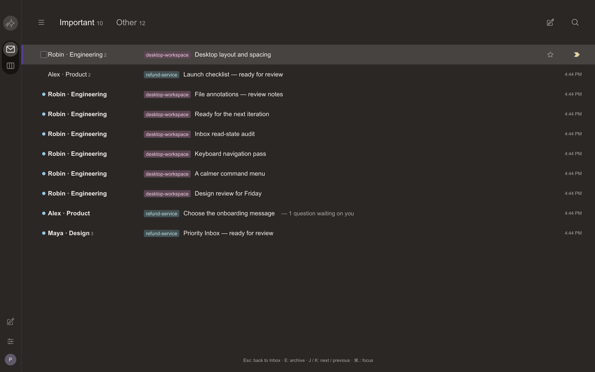

# Plannotator Superhuman

A separate version based on the qualified [Gmail fork](https://github.com/seb-veto/plannotator-gmail/tree/8cd6687322718ee2a2c8748cafb7244f7774ac67). Sebastian selected **current dark desktop Inbox** as the visual target. The official September 2026 theme image locks the warm Carbon palette, narrow rail, split-tab header, flat rows, unread dots and purple focused-row edge. [Design and sources](DESIGN.md).

Important and Other divide live threads using the existing importance override and waiting-work default; read state stays independent of unanswered questions. Stars, Unread, Sent, All mail, projects, Board, compose, search, replies, reviews and files retain the Plannotator backend. The split counters count conversations; Inbox/project badges count unseen threads. Arrow keys move between split tabs; Tab keeps normal keyboard focus navigation. E/Z/J/K/Escape and Command-period retain their input guards. Focus mode hides the rail and split header, preserving the active reply draft.

The rail's second mode opens the real Plannotator Board. Command search opens real conversation search. These deliberately replace the reference's calendar and AI integrations; this version does not pretend to provide those services. Product identity, agent content and file/review controls remain Plannotator. A screenshot crop does not establish pixel equality for unseen proprietary screens.

## Run separately

```sh
bun install --frozen-lockfile --ignore-scripts
bun run --cwd apps/review build
bun run --bun build:hook
bun run --bun build:opencode
mkdir -p .local/runtime
bun build apps/hook/server/index.ts --compile --no-compile-autoload-bunfig \
  --define '__CLI_VERSION__="0.28.33+plannotator-superhuman.4"' \
  --outfile .local/runtime/plannotator
./scripts/run-plannotator-superhuman.sh
```

Use Bun 1.4.4 and the launcher. It defaults to `~/.plannotator-superhuman` with automatic agent connection disabled. All browser preferences use the `plannotator-superhuman-` prefix. The inherited Gmail/v2 launcher aliases in this checkout point here too, avoiding accidental writes to another fork. Original, Craft and Gmail directories/data remain unchanged. No existing Inbox migration, real agent connection or installed-binary replacement is part of this version.

## Work and acceptance

Owner: Codex, this conversation. Scope: another separate version matching the selected Superhuman reference as closely as accessible evidence allows.

1. Recover the current reference and isolate source/preferences/data.
2. Implement the rail, split list, controls and reader using existing workflows.
3. Verify partitioning, independent storage, keyboard/accessibility and regression guards; build in order; exercise the compiled artifact in Aside; compare rendered palette and geometry; package and link the exact source/build/preview.

Final qualification and known limits are recorded with the delivered candidate. Earlier failed layout assertions remain in private receipts; only layout expectations change, never question/skip, archive, Undo or typing guards.

## Qualification

63 focused checks pass: split/tag model 3, mail controls 3, split-tab keyboard behavior 1, storage isolation 1, existing read/archive 17, attachment/file navigation 11, ThemeProvider 22, and shortcut guards 5. Inbox TypeScript and the review → hook → OpenCode build chain pass. Native Aside checks bind the final compiled executable to the tested synthetic fixture and exercise palette/geometry, splits, markers, unread, selection/archive/Undo, search, compose, reader focus, draft-preserving focus mode, files, Escape and J/K. The delivery receipt identifies the exact source and executable.

The original regression tests assumed Gmail's group placement and an expanded sidebar. Those layout expectations now follow Important/Other and a collapsed default; question/skip, archive, Undo and typing guards remain. Native QA caught an actual hidden-marker defect caused by tooltip wrappers; the descendant hover/focus selector was repaired and replayed.

The current official reference is an illustrated crop. Warm palette samples match exactly; dimensions and typography are reconstructed at an assumed illustration scale, not validated against a complete current app capture. Literal pixel-by-pixel identity is **unverified**. Mobile emulation is unavailable through this Aside connection (`setViewportSize` is unsupported); no real-device or mobile rendering pass is claimed. Real agent activation, existing-data migration, printing, full-repository tests and physical keyboard input were not performed.



[Reader](thread.png) · [Focus mode](focus.png).

Steps 1–3 above are complete for this review candidate. The remaining acceptance gap is literal pixel equality beyond the public illustrated reference; it needs a full, exact reference capture and the matching font/viewport.
