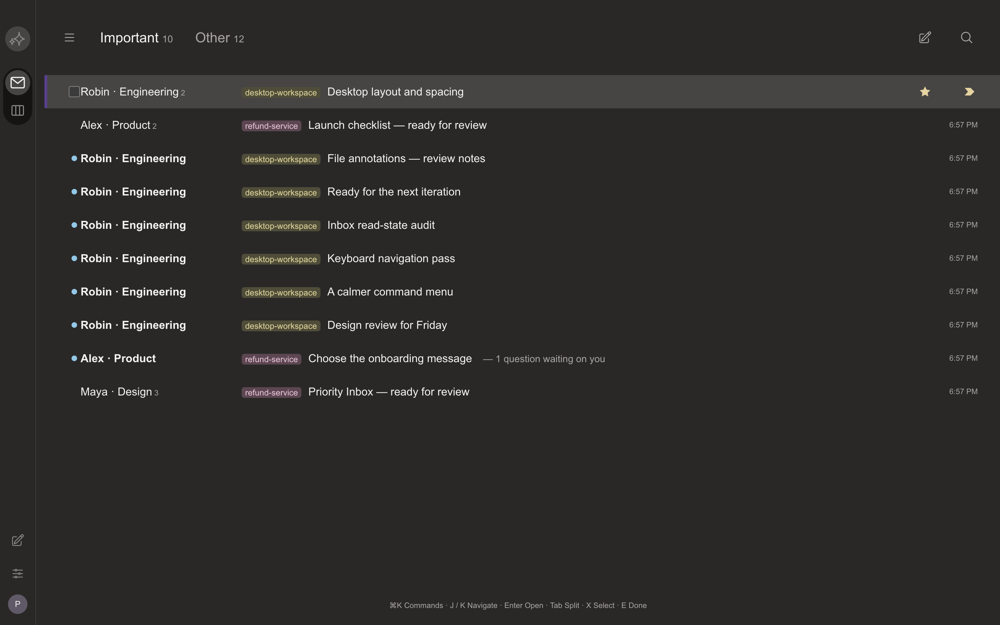

# Plannotator Superhuman

A separate version based on the qualified [Gmail fork](https://github.com/seb-veto/plannotator-gmail/tree/8cd6687322718ee2a2c8748cafb7244f7774ac67). Sebastian selected **current dark desktop Inbox** as the visual target. The official September 2026 theme image locks the warm Carbon palette, narrow rail, split-tab header, flat rows, unread dots and purple focused-row edge. [Design and sources](DESIGN.md).

Important and Other divide live threads using the existing importance override and waiting-work default; read state stays independent of unanswered questions. Stars, Unread, Sent, All mail, projects, Board, compose, search, replies, reviews and files retain the Plannotator backend. The split counters count conversations; Inbox/project badges count unseen threads. Arrow keys move between split tabs. Tab/Shift-Tab changes splits from a conversation row and keeps normal focus navigation on other controls. E/Z/J/K/Escape and Command-period retain their input guards. Focus mode hides the rail and split header, preserving the active reply draft.

The rail's second mode opens the real Plannotator Board. Command-K opens the real action menu; slash opens conversation search. These deliberately replace the reference's calendar and AI integrations; this version does not pretend to provide those services. Product identity, agent content and file/review controls remain Plannotator. A screenshot crop does not establish pixel equality for unseen proprietary screens.

## Run separately

```sh
bun install --frozen-lockfile --ignore-scripts
bun run --cwd apps/review build
bun run --bun build:hook
bun run --bun build:opencode
mkdir -p .local/precision-runtime
bun build apps/hook/server/index.ts --compile --no-compile-autoload-bunfig \
  --define '__CLI_VERSION__="0.28.33+plannotator-superhuman.5"' \
  --outfile .local/precision-runtime/plannotator
PLANNOTATOR_SUPERHUMAN_BINARY="$PWD/.local/precision-runtime/plannotator" ./scripts/run-plannotator-superhuman.sh
```

Use Bun 1.4.4 and the launcher. It defaults to `~/.plannotator-superhuman` with automatic agent connection disabled. All browser preferences use the `plannotator-superhuman-` prefix. The inherited Gmail/v2 launcher aliases in this checkout point here too, avoiding accidental writes to another fork. Original, Craft and Gmail directories/data remain unchanged. No existing Inbox migration, real agent connection or installed-binary replacement is part of this version.

## Work and acceptance

Owner: Codex, this conversation. Scope: another separate version matching the selected Superhuman reference as closely as accessible evidence allows.

1. Recover the current reference and isolate source/preferences/data.
2. Implement the rail, split list, controls and reader using existing workflows.
3. Verify partitioning, independent storage, keyboard/accessibility and regression guards; build in order; exercise the compiled artifact in Aside; compare rendered palette and geometry; package and link the exact source/build/preview.

Final qualification and known limits are recorded with the delivered candidate. Earlier failed layout assertions remain in private receipts; only layout expectations change, never question/skip, archive, Undo or typing guards.

## Qualification

Candidate .5 adds the public walkthrough's Command-K flow and the official Mac shortcut sheet's navigation: J/K focuses Inbox rows, Enter opens, G then I/O/S/D/T/E/A changes views, Tab cycles splits, X and Shift-J/K select, E marks done, Shift-E restores, S stars, U toggles read, R/Enter replies and N/P steps messages. The typing, IME, repeated-key, file and dialog guards stay active. The command menu exposes supported Plannotator actions only; unavailable actions are disabled. Keyboard help comes from the same registry as the actions.

30 focused UI, shortcut and Board tests pass after the shared card-project and automatic-arrival changes. Inbox TypeScript and the full review → hook → OpenCode build chain pass. The compiled candidate is exercised in Aside against synthetic data: row geometry, J/K/Enter, split Tab, search/compose, Command filtering and execution, selection, star, archive/restore, reply typing guards, draft-preserving focus mode, N/P, Escape and Board label editing. Exact source, executable hash, screenshots and replay logs are bound by the delivery manifest and VERIFY.md. The shared automatic-arrival source also has its separate 41-test and compiled Aside proof in the automatic Inbox package.

The native visual replay caught a transparent Command menu caused by Aside's native recoloring. The existing theme workaround now assigns the floating surface and selected command their authored colors. A first keyboard replay assumed an unstarred initial row; later runs use the actual initial state and wait for saved state. These failed observations remain in the private evidence logs.

The [official April walkthrough](https://www.youtube.com/watch?v=a-gQqgBusrk) supplies actual Inbox/Command frames; the [September Carbon illustration](https://blog.superhuman.com/we-redesigned-superhuman-mail-for-ios-and-android/) supplies current dark colors. The walkthrough is light and the current dark image is cropped: complete current-dark pixel identity, proprietary font metrics and physical keyboard input remain unverified. Dimensions use an assumed illustration scale. Mobile, existing-data migration, real-agent activation, printing and the full-repository suite were not checked for this candidate.

The .4 delivered executable and preview remain preserved. The .5 package runs separately; it does not replace the shared installed Inbox. Existing cards retain labels, can change project without moving conversations, and use the corrected Icebox meaning of “do later.” New arrivals enter Inbox directly, preserving the selected conversation and draft.



[Command menu](precision-command.png) · [Reader](precision-reader.png) · [Board labels](precision-board.png).
